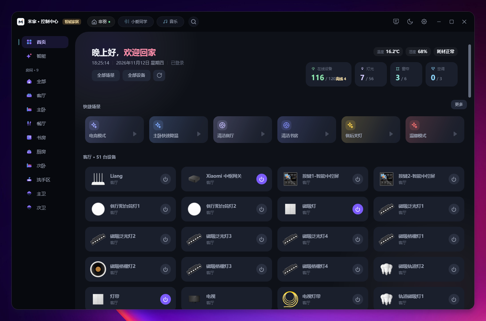
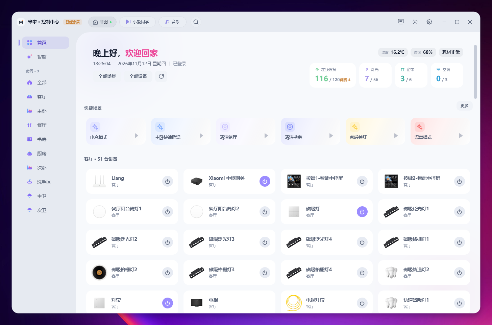
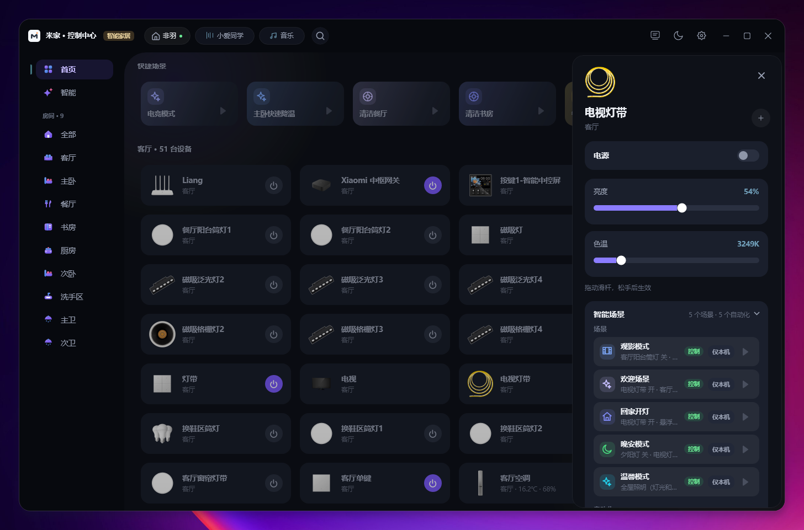
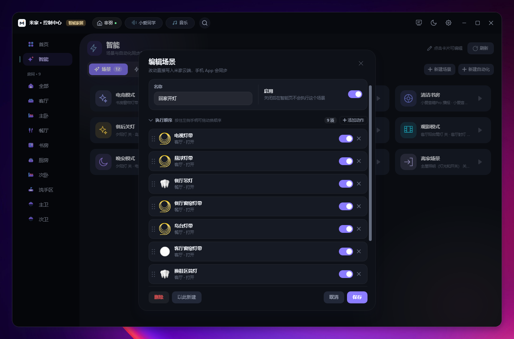
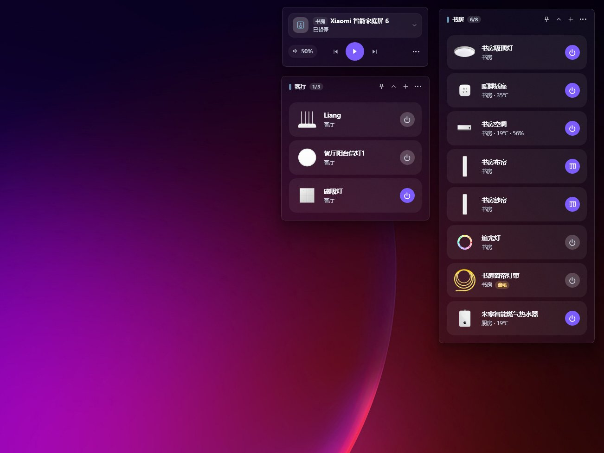

<div align="center">

# MiHomeHub

**把米家设备管得又好看、又好用的 Windows 桌面控制中心**

深色玻璃拟态 · 深浅双主题 · 全屋设备与场景尽在掌握 · 可视化自动化编辑 · 轻量常驻，后台仅几兆

[](LICENSE)
[](https://dotnet.microsoft.com)
[](https://avaloniaui.net)
[](#快速开始)
[](https://github.com/Feiyudevs/MiHomeHub/actions/workflows/build.yml)

基于 **Avalonia 11 + .NET 10** 原生构建，不是套壳、不是 Web 页面包装。
扫码登录即可接管你的全部米家设备——灯、空调、窗帘、开关、传感器、音箱、场景与自动化。

</div>

<p align="center">
  
  <br>
  <sub>深色主题 · 首页总览：房间导航、环境读数、设备概览与场景快捷入口</sub>
</p>

## 为什么是 MiHomeHub

市面上不缺米家第三方客户端，缺的是**既好看又能真的把设备管全**的那一个。
MiHomeHub 的取舍很明确：视觉不将就，控制不打折。

### 界面是设计出来的，不是拼出来的

- **深色 / 浅色双主题共享同一套玻璃拟态语言**——半透明卡片、分层圆角、克制的光影，不是简单地反色，而是两套各自成体系的配色。
- **无边框窗口 + 自定义标题栏**，标题栏与内容区无缝衔接，没有系统灰边和丑陋的原生控件。
- **每台设备自动拉取真机产品图**，矢量图标兜底：灯带、筒灯、磁吸格栅灯、网关、电视，一眼可辨，而不是清一色的通用图标。
- **统一的动效与状态反馈**：场景卡悬停浮起、设备卡电源键由灰转紫、抽屉从右侧滑入，点哪里都有回应。
- 场景卡按语义着色——电竞是紫、温馨是红、清洁是青，一眼扫过去就知道该点哪个。

### 流畅靠架构，不靠祈祷

- **滚动时不重建**：整屏设备卡滑动是复用而不是反复创建，五十多台设备的房间照样跟手。
- **首屏不等网络**：启动先用上次的设备快照把界面铺满，再在后台悄悄刷新——不用对着转圈等。
- **重活都在后台**：真机产品图、设备能力都在后台加载好再上屏，鼠标和动画不受牵连。
- **一个 exe 就够**：单文件自包含，不用装 .NET 运行时，双击即用。
- **轻量常驻**：主窗口收进托盘时，整个界面是被**卸下**而不是藏起来，桌面只留卡片，内存回落到几兆 —— 详见[资源占用](#资源占用)。

### 控制齐全，不挑型号

- **常用品类做深**：灯的亮度 / 色温 / 模式，空调的模式 / 温度 / 风速 / 摆风，窗帘的开合 / 暂停 / 百分比，开关插座、传感器、环境读数、耗材寿命。
- **冷门型号也能控**：面板按设备自己的能力自动生成——该出现滑杆就滑杆，该出现下拉就下拉，新买的设备不用等适配，**不为单个型号写死**。
- **设备组与组内成员**（灯组、开关组）一起开关，组里任何一台状态变了都会同步；单盏灯也能查出它所在灯组的场景和自动化。
- **小爱音箱**：语音指令下发、音量与播放控制。

### 功能强大，一直做到自动化编辑

- **场景 / 自动化可视化编辑**：改名、启停、**拖拽调整执行顺序**、增删动作，改完直接写回米家云端，手机 App 同步生效——不是在本地做假动作。
- **设备详情抽屉**：控制项与关联的智能场景、自动化清单同屏呈现，并标注「场景 / 控制 / 仅本机」来源，不用再回手机翻。
- **全局搜索、房间分组、多家庭切换**，设备再多也能三步之内找到。
- **桌面分区卡片**：把常用设备与场景贴到桌面，可以跨房间混着摆，多块屏幕都能放——不打开主界面也能控制，详见[桌面组件](#桌面组件)。
- **托盘常驻 + 快捷菜单 + 开机自启**，深浅主题与外观细节可调。

## 界面

<table>
  <tr>
    <td width="50%" align="center">
      <br>
      <sub><b>浅色主题</b> · 同一套布局，完全不同的呼吸感</sub>
    </td>
    <td width="50%" align="center">
      <br>
      <sub><b>设备抽屉</b> · 亮度色温滑杆 + 关联场景清单</sub>
    </td>
  </tr>
</table>

<p align="center">
  
  <br>
  <sub><b>场景编辑</b> · 执行顺序可拖拽，逐条动作带设备图标，改完直写云端</sub>
</p>

## 桌面组件

主界面之外还有一层：把常用的设备、场景和音箱**钉到桌面本身**，不打开窗口也能随手控制。
卡片是半透明的，壁纸的颜色会从底下透上来——和系统长在一起，而不是桌面上多了一块板子。

<p align="center">
  
  <br>
  <sub><b>桌面组件</b> · 设备分区卡 + 音箱播放卡，随壁纸透光的玻璃拟态</sub>
</p>

- **一张卡就是一处置物架**：放什么自己挑，客厅的灯可以和书房的空调摆进同一张卡，不必按房间分组。
- **开着几个，一眼看到**：标题栏的 `6/8` 是「当前开着 6 个 / 共 8 个」——扫一眼就知道有没有忘了关的灯。
  传感器的温度湿度直接印在设备行上，掉线的设备灰下去并标「离线」，不用点进去猜。
- **标题栏就几个按钮**：置顶、折叠 / 展开、添加设备或场景、分区菜单；点标题还能直接改名。
- **开关就在格子上**：灯、插座、窗帘、空调直接点，不用先进详情页。
- **音箱单独一张卡**：换哪台音箱、播放与暂停、上一首 / 下一首、音量，都在手边。
- **贴着桌面，不挡路**：默认嵌在壁纸层，开别的窗口不会被它挡着；需要时点图钉浮到最前，再点一次放回桌面。
- **多屏也能摆**：分区记住自己在哪块屏、摆在什么位置，重开还原。

## 资源占用

界面做得厚，不代表要吃得重。

- **前台也不重**：上百台设备、几十张卡片的房间照样轻快，不靠堆控件堆出来的华丽。
- **后台只留几兆**：收进托盘时主界面整个被卸下，桌面上只剩卡片那一小份 UI，挂着不心疼。
- **空闲会自己瘦下来**：滚动停下、切页之后、闲置一阵，都会把已经释放的东西还回去，高峰过后自动回落。
- **不拿流畅度换内存**：拖滚动条、切页动画期间一律不整理内存，宁可晚一点回收。

## 功能一览

| 分类 | 能力 |
| --- | --- |
| 账号 | 扫码登录、免扫码一键登录（沿用本机已保存的登录状态）、退出登录、多家庭切换 |
| 设备 | 房间分组、全局搜索、设备详情抽屉、状态轮询、离线标记、耗材与环境读数 |
| 控制 | 灯 / 空调 / 窗帘 / 开关插座面板，没适配过的型号也能自动生成控制项，设备组统一开关 |
| 场景 | 手动执行、可视化编辑（启停 / 排序 / 增删动作）、与米家云端双向同步 |
| 语音 | 小爱音箱语音指令、音量与播放控制 |
| 桌面 | 多显示器分区卡片、拖拽排序、托盘快捷菜单、开机自启 |
| 外观 | 深浅双主题、侧栏图标风格等外观选项，设置会记住 |

## 技术栈

| 项目 | 内容 |
| --- | --- |
| UI | Avalonia 11.3.9（Themes.Fluent、Svg.Skia） |
| 运行时 | .NET 10，`win-x64` 自包含单文件发布 |
| MVVM | CommunityToolkit.Mvvm 8.4.0 |
| 二维码 | QRCoder 1.6.0 |
| 构建 / 打包 | `build.cmd`、`package.cmd`、Inno Setup 6 |

性能相关的几处关键设计：

- 编译绑定 + 虚拟化网格（`VirtualizingAdaptiveGridPanel` / `RecyclingItemsControl`），复用卡片而非每次重建
- 缓存优先渲染，网络请求异步补齐
- 设备图标与 MIoT 规格分离加载，失败自动降级到矢量图标
- 后台驻留时卸载界面树并归还内存（`MemoryTrimmer`），空闲与滚停自动整理，避让滚动和动画
- 发布不做裁剪：界面绑定与数据序列化依赖运行时反射，裁掉会让界面变空壳（因此以体积换稳定）

## 目录

```
MiHomeHub/
├── MiHome.csproj / Program.cs / App.axaml(.cs)
├── Assets/          # 矢量图标与程序图标
├── Controls/        # 自定义控件（虚拟化网格、拖拽排序、浮层等）
├── Converters/      # XAML 值转换器
├── Themes/          # 画笔、模板与样式
├── Models/          # 设备、场景、规格、设置等模型
├── Services/        # 登录与加解密、云端 API、规格/图标、缓存、托盘与桌面钩子
├── ViewModels/      # MVVM 视图模型（按功能拆分 partial）
├── Views/           # AXAML 视图与 code-behind
├── docs/            # 构建与技术文档、界面截图
├── installer/       # Inno Setup 脚本
├── scripts/         # 编译、发布、打包与 GitHub Release 脚本
└── .github/         # CI 与 issue 模板
```

## 快速开始

环境：Windows x64、.NET 10 SDK（版本由 `global.json` 固定为 `10.0.301`，允许 `latestPatch`）。
仅生成安装包时需要 Inno Setup 6。

```bat
build.cmd                  :: 编译 + 单文件发布 + 启动
build.cmd -NoRun           :: 只编译
package.cmd                :: 按当前版本打包（exe + 安装包 + SHA256）
package.cmd -Bump patch    :: 升版本后打包
package.cmd -SkipInstaller :: 只出单文件 exe
```

产物：`publish\sc-win-x64\MiHome.exe`（启动与回归的固定路径）、
`publish\release\<版本>\`（发版目录）。完整流程见 [docs/一键编译与打包.md](docs/一键编译与打包.md)。

> 只运行 publish 产物，不要运行 `bin\Release` 下的中间产物（裁剪与自包含行为不一致）。
> 应用为托盘常驻，关闭窗口只收进托盘；发布脚本会精确结束占用发布 exe 的旧实例。

等价的 PowerShell 入口：`.\scripts\build.ps1 [-NoRun]`、`.\scripts\release.ps1 [-Bump patch] [-SkipInstaller]`。

## 使用

1. 运行 `publish\sc-win-x64\MiHome.exe`。
2. 首次在设置 → 账号中点「获取二维码」，用米家 App 扫码登录。
3. 登录后自动同步家庭、房间、设备与场景；后续启动可一键登录。

登录凭证保存在 `%APPDATA%\Feiyu\MiHome\auth.json`，以 Windows DPAPI 加密（仅当前用户可解密），
**不要提交或分享**，详见 [SECURITY.md](SECURITY.md)。

## 文档

- [构建与打包](docs/一键编译与打包.md)
- [贡献指南](CONTRIBUTING.md)
- [安全说明](SECURITY.md)

## 致谢

感谢以下开源项目：

- **[Do1e/mijia-api](https://github.com/Do1e/mijia-api)** —— 米家云端 API 的 Python 实现，本项目的登录、签名与加解密流程移植自该项目。

上游以 GNU GPL v3 发布，移植部分同样依 GPL-3.0 提供，版权归原作者所有。完整版权声明见 [NOTICE](NOTICE)。

## 许可证

GNU General Public License v3（`GPL-3.0-only`）。许可证全文见 [LICENSE](LICENSE)，
移植代码来源与版权声明见 [NOTICE](NOTICE)。

依据 GPL-3.0 第 6 节：分发本项目的可执行文件（单文件 exe、安装包）时，
对应版本的完整源代码可通过仓库 https://github.com/Feiyudevs/MiHomeHub 获取，
每个发布版本均以 Git 标签（如 `v1.0.0`）固定，标签上的源码即对应二进制的构建来源，
标签与源码将长期保留。本项目不附加任何超出 GPL-3.0 的限制条款。

---

<div align="center">
<sub>本项目与小米科技无隶属关系，米家、小米为小米科技有限责任公司商标。</sub>
</div>
