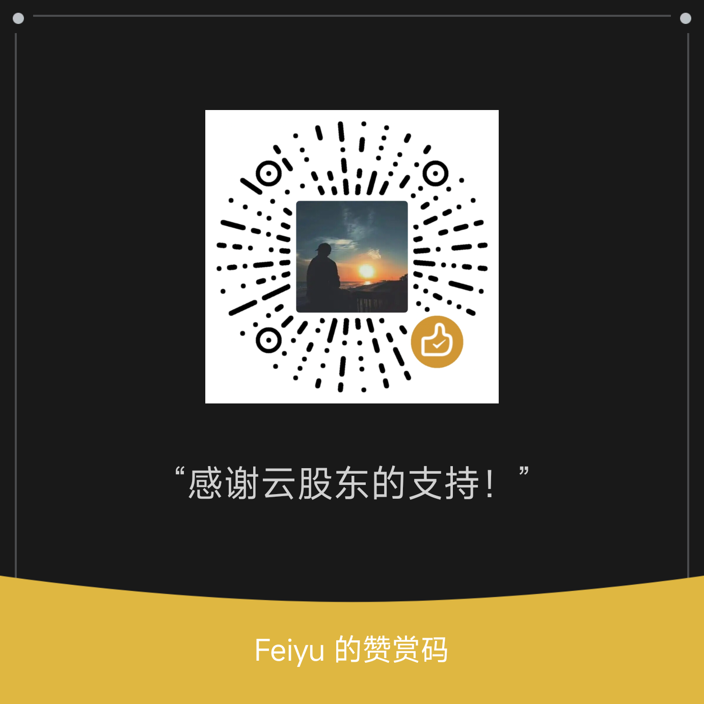

# 支持 MiHomeHub

**如果它帮你把家里那堆灯、空调和场景管顺了，可以扫码请作者喝杯咖啡**

MiHomeHub 没有团队、没有广告，也没有内购和付费墙：所有功能免费，源码按 GPL-3.0 全开。
维护它的时间都是从业余里挤出来的——少踩一个坑、少装一个第三方播放器，就已经值了；
如果还想再支持一下，下面两种方式金额随意，纯粹是心意。

<table>
  <tr>
    <td width="50%" align="center">
       
      <b>支付宝</b> 
      扫码转账，金额随意
    </td>
    <td width="50%" align="center">
       
      <b>微信</b> 
      扫码赞赏，可附一句留言
    </td>
  </tr>
</table>

> 赞赏是单向的心意，不构成服务承诺、功能定制或优先支持；
> 需要功能或反馈问题，请走仓库的 [Issues](https://github.com/Feiyudevs/MiHomeHub/issues)。

## 不打赏也算支持

一分钱不花同样可以帮上忙，下面这些比赞赏更有用：

- 在 [Issues](https://github.com/Feiyudevs/MiHomeHub/issues) 里报一个能复现的问题：写清版本号、哪台设备、点了什么、看到什么
- 把用着不顺手的地方写具体（哪个页面、期望是什么），比「不太好用」更容易改
- 给仓库点一颗 Star，让更多在折腾米家的人找到它
- 转载或推荐给同样被米家生态困住的朋友

## 说明

- 赞赏不换取任何功能、授权或定制开发，项目始终按 [GPL-3.0](LICENSE) 分发。
- 收款码仅用于个人对个人的心意支持，与小米科技无关。

本项目与小米科技无隶属关系，米家、小米为小米科技有限责任公司商标。

